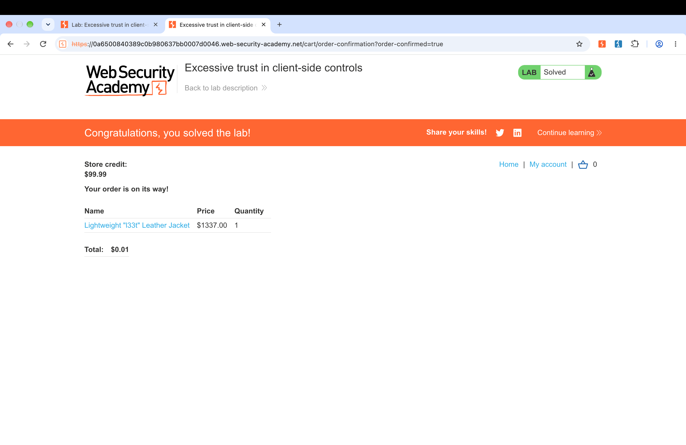

# Arbeitsbericht: Burp-Suite

* **Klasse:** 5AHITS
* **Name:** Anes Sejdic, Aldin Mukic
* **Fach:** ITSE
* **Datum:** 2026-11-13
* **Aufgabe:** [Burp-Suite](https://www.franzmatejka.at/htl/doc/ITSI_5/itsi5-lab/03_burp.html)

---

## Inhaltsverzeichnis

1. [Übung  3.2 (Burp Suite Intro)](#1-burp-suite-intro)
2. [Übung  3.4 (TryHackMe – Neighbour)](#2-tryhackme-neighbour)
3. [Übung  3.5 (TryHackMe – Burpsuite Repeater)](#3-tryhackme-burpsuite-repeater)

---

**Portswigger und TryHackMe Accounts erfolgreich erstellt.**

# 1. Burp Suite Intro

**Aufgabenstellung**: Arbeite dich durch das Kapitel "Getting startet": [PortSwigger - Getting started with Burp Suite](https://portswigger.net/burp/documentation/desktop/getting-started)

Überspringe die Punkte für die eine Pro Version von Burp notwendig ist.

## 1.1 Durchführung

Alle Aufgaben erfolgreich nach der Anleitung durchgemacht!

---

# 2. TryHackMe Neighbour

**Aufgabenstellung**: 
- Konfiguriere den [OpenVPN Zugang](https://tryhackme.com/access) zu TryHackMe in Kali Linux.
- Löse den THM Room Neighbour: [Übung Neighbour](https://www.franzmatejka.at/htl/doc/ITSI/lab/THM/Neighbour/Neighbour.html)

## 2.1 Durchführung

*(folgt)*

## 2.2 Ergebnis

*(folgt)*

---

# 3. Übung (TITEL)

**Aufgabenstellung**: ...

## 3.1 Durchführung

*(folgt)*

## 3.2 Ergebnis

*(folgt)*

---

# Fazit

Was wurde gelernt? Was war schwierig? Wofür ist das Gelernte in der Praxis nützlich?

---

# Quellen

* [Titel der Quelle](https://example.com)
* [Titel der Quelle](https://example.com)
